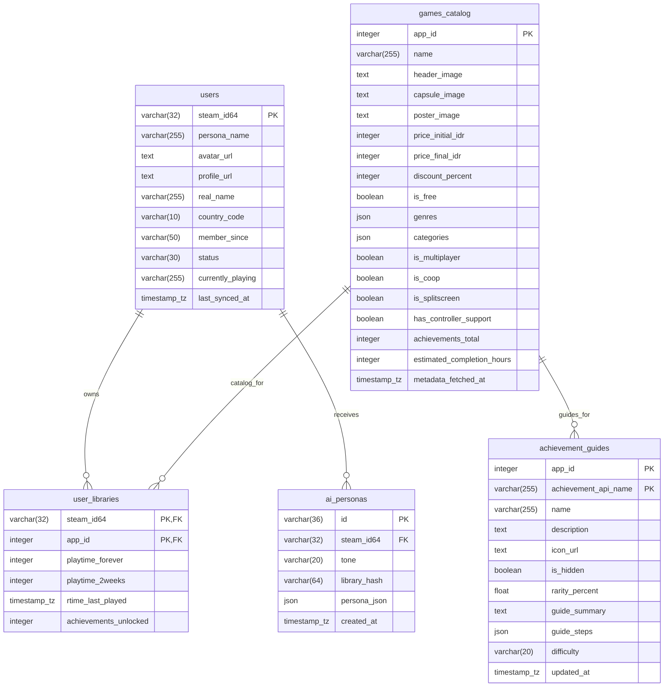

# VALVIX — Engineering Architecture & Phased Implementation Plan
*Tactical Steam Library Telemetry, Squad Co-op Matcher & AI Persona Generator*

> **Status: Implemented (Historical Blueprint)**  
> This document is the initial architecture blueprint created at project kickoff. The actual implemented codebase has evolved (including **multi-currency global support** with `USD` default, **concurrent Steam & Storefront batch syncing**, **custom Valvix brand mark**, and a **clean dark obsidian UI**).  
> For up-to-date documentation aligned with the current code, see:
> - [Project README](README.md)
> - [High-Level Architecture](docs/HIGH_LEVEL_ARCHITECTURE.md)
> - [Frontend Technical Guide](docs/FRONTEND_TECH.md)
> - [Backend Technical Guide](docs/BACKEND_TECH.md)

---

## 1. Executive Summary & System Overview

**Valvix** is a high-utility web application engineered for PC gamers seeking actionable telemetry on their Steam investments, frictionless squad co-op session planning, and brutal AI-generated gaming persona roasts.

### Core Value Propositions
1. **Smart Backlog & Value Telemetry:** Actionable triage (*Zero-Hour Pile of Shame*, *Quick Wins*, *Unfinished Business*) cross-referenced with regional Indonesian Rupiah (IDR) pricing to calculate realistic Cost-Per-Hour metrics.
2. **Squad Co-op Intersector:** Zero-friction multiplayer matchmaking across 2+ Steam profiles without requiring friends to log in, featuring deterministic tag intersections and a high-tension squad roulette selector.
3. **AI Persona & Profile Roast:** Context-aware psychological archetype profiling and library roast powered by Google Gemini (`google-genai` SDK) utilizing strict JSON schemas and telemetry-hashing cache invalidation.

### Aesthetic Foundation: Modern Playful Game Lounge (Anti-Slop Protocol)
Valvix explicitly avoids generic corporate SaaS templates, cheesy neon purple glassmorphism, or impenetrable server terminal walls. Instead, it adopts a **Modern Playful Game Lounge** visual design system inspired by **Steam Deck UI, Letterboxd, Backloggd, and Spotify Wrapped**:
- **Palette:** Matte Obsidian canvas (`#0D0F14`), Elevated Surface card plates (`#151821`), Border hairlines (`rgba(255, 255, 255, 0.08)`), accented with vibrant gaming signals: Sharp Emerald (`#00E599`) for value and efficiency, Industrial Orange (`#FF5500`) for backlog shame, Cyber Sky (`#38BDF8`) for multiplayer and squad hubs, and Royal Purple (`#A855F7`) for rare trophies and AI persona badges.
- **Artwork Hero (Visual > Text):** Official Steam vertical library posters (`library_600x900.jpg` at 2:3 aspect ratio) with high-contrast floating badges (`bg-black/80 backdrop-blur-sm border border-white/10`) and zero text clutter or dark mud overlays.
- **Typography:** Space Grotesk (Bold geometric headers), Inter (Clean modern UI copy), JetBrains Mono (Data metrics, AppIDs, and IDR pricing with `tabular-nums`).
- **Geometry & Polish:** Modern `12px` - `16px` border radii, micro-interactions powered by Framer Motion, slide-over achievement drawers, and offline-resilient inline SVG avatar generators.

---

## 2. Monorepo Repository Structure

```text
valvix/
├── .github/
│   └── workflows/
│       ├── ci-backend.yml
│       └── ci-frontend.yml
├── backend/
│   ├── alembic/
│   │   ├── env.py
│   │   └── versions/
│   ├── app/
│   │   ├── api/
│   │   │   ├── deps.py                  # Database session, Steam client, Gemini client injection
│   │   │   └── v1/
│   │   │       ├── router.py            # API v1 aggregator
│   │   │       ├── auth.py              # OpenID 2.0 login & validation
│   │   │       ├── users.py             # User profile resolution & sync status
│   │   │       ├── library.py           # Library retrieval, metrics, and backlog filters
│   │   │       ├── squad.py             # Multi-profile intersection & roulette
│   │   │       └── persona.py           # Gemini archetype & roast generation
│   │   ├── core/
│   │   │   ├── config.py                # Pydantic v2 BaseSettings
│   │   │   ├── database.py              # Async engine & sessionmaker (SQLAlchemy 2.0)
│   │   │   ├── security.py              # Session token generation & verification
│   │   │   └── rate_limiter.py          # Leaky bucket / asyncio.Semaphore controllers
│   │   ├── models/
│   │   │   ├── base.py                  # DeclarativeBase with timestamp mixins
│   │   │   ├── user.py                  # User & UserSession models
│   │   │   ├── game.py                  # Global Game catalog model
│   │   │   ├── user_game.py             # Many-to-Many library join table
│   │   │   └── persona.py               # Cached AI Persona snapshots
│   │   ├── schemas/
│   │   │   ├── user.py                  # Steam profile & auth DTOs
│   │   │   ├── game.py                  # Game metadata & price DTOs
│   │   │   ├── library.py               # Backlog & Cost-Per-Hour telemetry DTOs
│   │   │   ├── squad.py                 # Squad intersection query & response DTOs
│   │   │   └── persona.py               # Structured Gemini input & output schemas
│   │   ├── services/
│   │   │   ├── steam_web_api.py         # GetPlayerSummaries, GetOwnedGames, VanityURL
│   │   │   ├── steam_store_api.py       # appdetails crawler with Semaphore & IDR currency
│   │   │   ├── sync_service.py          # Background task orchestration for user library sync
│   │   │   ├── squad_service.py         # Fast SQL intersection engine
│   │   │   └── gemini_service.py        # google-genai structured JSON prompt orchestrator
│   │   └── main.py                      # FastAPI application entrypoint & middleware
│   ├── tests/
│   │   ├── conftest.py
│   │   ├── test_library.py
│   │   ├── test_squad_intersection.py
│   │   └── test_gemini_persona.py
│   ├── alembic.ini
│   ├── pyproject.toml
│   ├── requirements.txt
│   └── Dockerfile
├── frontend/
│   ├── public/
│   │   ├── favicon.svg
│   │   └── fonts/
│   ├── src/
│   │   ├── assets/
│   │   ├── components/
│   │   │   ├── ui/                      # Customized Shadcn components (sharp 4px radius)
│   │   │   │   ├── button.tsx
│   │   │   │   ├── badge.tsx
│   │   │   │   ├── card.tsx
│   │   │   │   ├── dialog.tsx
│   │   │   │   ├── input.tsx
│   │   │   │   ├── popover.tsx
│   │   │   │   ├── select.tsx
│   │   │   │   ├── tabs.tsx
│   │   │   │   └── tooltip.tsx
│   │   │   ├── common/
│   │   │   │   ├── Navbar.tsx           # HUD status bar & steam identifier input
│   │   │   │   ├── MetricPill.tsx       # Tabular metric container
│   │   │   │   ├── SteamArtwork.tsx     # Aspect-ratio locked capsule & header loader
│   │   │   │   └── SyncProgressHUD.tsx  # Dynamic sync telemetry indicator
│   │   │   ├── dashboard/
│   │   │   │   ├── BentoGrid.tsx        # 60/40 Asymmetric HUD layout
│   │   │   │   ├── TelemetryHero.tsx    # Library valuation, playtime, cost/hour
│   │   │   │   ├── BacklogEngine.tsx    # Pile of Shame, Quick Wins, Unfinished
│   │   │   │   └── LibraryTable.tsx     # TanStack Table with virtualized scrolling
│   │   │   ├── squad/
│   │   │   │   ├── SquadBuilder.tsx     # Multi-player tag input & resolution
│   │   │   │   ├── IntersectionGrid.tsx # Co-op matches with tag chips
│   │   │   │   └── SquadRoulette.tsx    # Mechanical easing picker wheel
│   │   │   └── persona/
│   │   │       ├── PersonaCard.tsx      # Cyber-tactical identity passport
│   │   │       ├── RoastBox.tsx         # Monospace scathing commentary box
│   │   │       └── CardExporter.tsx     # Image rendering via html-to-image
│   │   ├── hooks/
│   │   │   ├── useSteamSync.ts
│   │   │   ├── useLibraryQuery.ts
│   │   │   ├── useSquadIntersection.ts
│   │   │   └── usePersonaGenerator.ts
│   │   ├── lib/
│   │   │   ├── api-client.ts            # Axios / fetch instance with error interceptors
│   │   │   ├── currency.ts              # IDR formatting utility (Rp xx.xxx.xxx)
│   │   │   └── utils.ts                 # cn() class merge helper
│   │   ├── styles/
│   │   │   └── globals.css              # Custom properties & tactical scanlines
│   │   ├── types/
│   │   │   ├── api.d.ts
│   │   │   └── library.d.ts
│   │   ├── App.tsx
│   │   └── main.tsx
│   ├── index.html
│   ├── package.json
│   ├── tailwind.config.ts
│   ├── tsconfig.json
│   └── vite.config.ts
├── docker-compose.yml
├── .env.example
├── .gitignore
└── IMPLEMENTATION_PLAN.md
```

---

## 3. System Architecture & Data Flow

```mermaid
flowchart TD
    subgraph Client["Frontend Client (React + Tailwind + TanStack + Motion)"]
        UI[Tactical HUD Dashboard]
        SyncTrigger[Sync / Profile Input]
        SquadUI[Squad Co-op Intersector]
        PersonaUI[AI Persona & Roast Card]
    end

    subgraph Gateway["FastAPI Application Server"]
        Router[API v1 Router]
        AuthEngine[OpenID 2.0 Auth / Vanity Resolver]
        SyncEngine[Library Sync Engine]
        SquadEngine[Intersection SQL Engine]
        AIEngine[Gemini Persona Service]
        RateLimiter[Asyncio Semaphore & Store Queue]
    end

    subgraph Storage["Persistent Storage (PostgreSQL 16)"]
        Users[(users)]
        Games[(games_catalog - Shared Cache)]
        UserGames[(user_games - Playtime)]
        Personas[(cached_personas - Hash Keyed)]
    end

    subgraph External["External APIs"]
        SteamWeb["Steam Web API<br/>GetOwnedGames / Summaries"]
        SteamStore["Steam Store API<br/>appdetails / IDR Currency"]
        Gemini["Google Gemini API<br/>gemini-2.5-flash / Structured JSON"]
    end

    SyncTrigger -->|"1. SteamID / Vanity URL"| Router
    Router --> AuthEngine
    AuthEngine -->|"Resolve ID64"| SteamWeb

    Router --> SyncEngine
    SyncEngine -->|"Fetch Owned Games"| SteamWeb
    SyncEngine -->|"Batch Upsert User Playtime"| UserGames
    SyncEngine -->|"Check Missing Catalog Apps"| Games
    SyncEngine -->|"Queue Missing Metadata"| RateLimiter
    RateLimiter -->|"Bounded Store Crawl max 1.5 req/s"| SteamStore
    SteamStore -->|"Store Metadata, IDR Base Price, Tags"| Games

    SquadUI -->|"2. Query Intersected Games (ID1, ID2, ID3)"| Router
    Router --> SquadEngine
    SquadEngine -->|"Optimized Aggregation Query"| UserGames
    UserGames -->|"Join Metadata"| Games
    SquadEngine -->|"Return Common Co-op Titles"| SquadUI

    PersonaUI -->|"3. Request Persona (Force Refresh or Cache)"| Router
    Router --> AIEngine
    AIEngine -->|Compute Library Telemetry Hash| Personas
    Personas -- Cache Hit --> AIEngine
    AIEngine -- Cache Miss -->|Send Telemetry Summary JSON| Gemini
    Gemini -->|Return Schema Validated JSON| AIEngine
    AIEngine -->|Store Persona Record| Personas
    AIEngine -->|Deliver Archetype & Roast| PersonaUI
```

---

## 4. PostgreSQL Database Schema

### 4.1 Schema Design Principles
1. **Shared Catalog Deduplication:** Game metadata (capsules, genres, tags, IDR pricing) is decoupled from users. 100 users owning *Cyberpunk 2077* point to a single row in `games_catalog`.
2. **Deterministic Intersections:** The `user_games` table acts as a composite-indexed bridge table. Intersections across $N$ profiles execute via indexed `steam_id` grouping with `HAVING count(DISTINCT steam_id) = :n`.
3. **Telemetry Caching:** AI generation queries compute a SHA-256 hash of `(steam_id, total_games, total_playtime_forever, top_5_appids)`. If the hash exists in `user_personas`, the cached JSON is returned instantly with zero LLM token cost.

### 4.2 Entity Relationship Diagram (ERD)



### 4.3 Production DDL & Indexes

```sql
-- Enable UUID generation
CREATE EXTENSION IF NOT EXISTS "uuid-ossp";

-- 1. Users Table
CREATE TABLE users (
    steam_id64 VARCHAR(32) PRIMARY KEY,
    vanity_url VARCHAR(64) NULL,
    persona_name VARCHAR(128) NOT NULL,
    avatar_url VARCHAR(255) NOT NULL,
    profile_url VARCHAR(255) NOT NULL,
    is_public BOOLEAN DEFAULT TRUE NOT NULL,
    last_synced_at TIMESTAMP WITH TIME ZONE NULL,
    created_at TIMESTAMP WITH TIME ZONE DEFAULT CURRENT_TIMESTAMP NOT NULL,
    updated_at TIMESTAMP WITH TIME ZONE DEFAULT CURRENT_TIMESTAMP NOT NULL
);

CREATE INDEX idx_users_vanity_url ON users(vanity_url) WHERE vanity_url IS NOT NULL;

-- 2. Global Games Catalog (Global Static Cache)
CREATE TABLE games_catalog (
    app_id INTEGER PRIMARY KEY,
    name VARCHAR(255) NOT NULL,
    game_type VARCHAR(64) DEFAULT 'game' NOT NULL,
    is_free BOOLEAN DEFAULT FALSE NOT NULL,
    price_initial_idr BIGINT DEFAULT 0 NOT NULL,
    price_final_idr BIGINT DEFAULT 0 NOT NULL,
    discount_percent INTEGER DEFAULT 0 NOT NULL,
    header_image VARCHAR(512) NULL,
    capsule_image VARCHAR(512) NULL,
    genres JSONB DEFAULT '[]'::jsonb NOT NULL,
    categories JSONB DEFAULT '[]'::jsonb NOT NULL,
    is_multiplayer BOOLEAN DEFAULT FALSE NOT NULL,
    is_coop BOOLEAN DEFAULT FALSE NOT NULL,
    is_split_screen BOOLEAN DEFAULT FALSE NOT NULL,
    has_controller_support BOOLEAN DEFAULT FALSE NOT NULL,
    metadata_updated_at TIMESTAMP WITH TIME ZONE NULL,
    store_fetch_failed BOOLEAN DEFAULT FALSE NOT NULL
);

-- Fast categorization and filter indexes
CREATE INDEX idx_games_catalog_coop ON games_catalog(is_coop) WHERE is_coop = TRUE;
CREATE INDEX idx_games_catalog_multiplayer ON games_catalog(is_multiplayer) WHERE is_multiplayer = TRUE;
CREATE INDEX idx_games_catalog_metadata_age ON games_catalog(metadata_updated_at);
CREATE INDEX idx_games_catalog_gin_genres ON games_catalog USING GIN(genres);
CREATE INDEX idx_games_catalog_gin_categories ON games_catalog USING GIN(categories);

-- 3. User Games (Bridge Table for Playtime & Library)
CREATE TABLE user_games (
    steam_id64 VARCHAR(32) NOT NULL REFERENCES users(steam_id64) ON DELETE CASCADE,
    app_id INTEGER NOT NULL REFERENCES games_catalog(app_id) ON DELETE CASCADE,
    playtime_forever INTEGER DEFAULT 0 NOT NULL, -- minutes
    playtime_2weeks INTEGER DEFAULT 0 NOT NULL,  -- minutes
    last_played_at TIMESTAMP WITH TIME ZONE NULL,
    updated_at TIMESTAMP WITH TIME ZONE DEFAULT CURRENT_TIMESTAMP NOT NULL,
    PRIMARY KEY (steam_id64, app_id)
);

-- Essential index for multi-user intersection queries
CREATE INDEX idx_user_games_app_id_steam_id ON user_games(app_id, steam_id64);
CREATE INDEX idx_user_games_playtime ON user_games(steam_id64, playtime_forever);

-- 4. User Personas (AI Output Cache)
CREATE TABLE user_personas (
    id UUID PRIMARY KEY DEFAULT uuid_generate_v4(),
    steam_id64 VARCHAR(32) NOT NULL REFERENCES users(steam_id64) ON DELETE CASCADE,
    telemetry_hash VARCHAR(64) NOT NULL,
    archetype_title VARCHAR(128) NOT NULL,
    playstyle_summary TEXT NOT NULL,
    strengths JSONB DEFAULT '[]'::jsonb NOT NULL,
    comedy_roast TEXT NOT NULL,
    top_genres JSONB DEFAULT '[]'::jsonb NOT NULL,
    generated_at TIMESTAMP WITH TIME ZONE DEFAULT CURRENT_TIMESTAMP NOT NULL,
    CONSTRAINT uq_user_persona_hash UNIQUE (steam_id64, telemetry_hash)
);

CREATE INDEX idx_personas_steam_id ON user_personas(steam_id64);
```

---

## 5. External API Resiliency & Concurrency Controls

### 5.1 Steam Web API
- `ISteamUser/ResolveVanityURL`: Resolves custom vanity names (`steamcommunity.com/id/username`) to 64-bit SteamIDs.
- `ISteamUser/GetPlayerSummaries`: Fetches persona name, avatar, and visibility state.
- `IPlayerService/GetOwnedGames`: Retrieves full list of AppIDs with `playtime_forever` and `playtime_2weeks` (flag `include_played_free_games=1`).

### 5.2 Steam Store API Rate-Limiting Strategy
The Steam Store API endpoint (`https://store.steampowered.com/api/appdetails?appids={app_id}&cc=id&l=indonesian`) enforces strict rate limits (~200 requests / 5 minutes, or ~1.5 requests/second).
- **Concurrency Guard:** All Store API fetches route through a dedicated singleton queue governed by `asyncio.Semaphore(value=1)` and token-bucket sleep intervals ($800\text{ms}$ delay per request).
- **Batching & On-Demand Fallback:** When a user syncs 500 games, basic entries are written to `games_catalog` immediately with `name` and stub images from the Steam CDN (`https://cdn.akamai.steamstatic.com/steam/apps/{app_id}/header.jpg`). A background worker enriches metadata asynchronously.
- **Circuit Breaker & Backoff:** On HTTP 429, the crawler immediately backs off exponentially ($30\text{s} \to 60\text{s} \to 120\text{s}$) and marks the queue paused.

### 5.3 Google Gemini Integration (`google-genai` SDK)
- **Model Choice:** `gemini-2.5-flash` for high throughput, low latency, and deterministic structured JSON adherence.
- **Schema Enforcement:** Use Pydantic models compiled into Gemini `response_schema` to guarantee valid JSON formatting without markdown wrappings.
- **Prompt Engineering Strategy:** Feed quantitative metrics (Zero-Hour count, total IDR wasted, top 3 played games with hundreds of hours, rarest achievements) into a structured system prompt that orders the model to deliver a lethal, witty roast and an astute gamer archetype.

---

## 6. API Endpoint Design & Schemas (Valvix REST API)

All API responses strictly enforce camelCase serialization to match `frontend/src/data/mockSteamData.ts`.

### 6.1 Core Profile & Library Engine
- `POST /api/sync/{identifier}`: Resolves input (SteamID64, profile URL, or vanity name), syncs profile details + owned games, warms catalog cache with IDR pricing, and returns a unified `SyncResponse`.
- `GET /api/users/{steam_id64}/overview`: Returns `LibraryOverview` containing aggregate playtime, IDR valuation, cost-per-hour, unplayed percentages, Spotlight card, Top Value, Most Played, and Unplayed Gem highlights.
- `GET /api/users/{steam_id64}/games`: Returns user's complete catalog with playtimes, vertical `library_600x900.jpg` poster URLs, genres, and achievement summaries.

### 6.2 Squad Co-op Matcher Engine
- `POST /api/coop/intersect` (alias: `POST /api/squad/intersect`):
  - Request: `{ "steamIds": ["76561197960287930", "76561198034561234"], "filterTag": "coop_only" }`
  - Filters: `all`, `coop_only`, `local_coop`, `controller_support`.
  - Performs indexed SQL intersection over `user_libraries` joined with `games_catalog`, returning shared titles with individual playtimes per member.

### 6.3 Achievement Tracking & AI Unlock Guides
- `GET /api/games/{app_id}/achievements/{steam_id64}`: Fetches game schema and player achievements, merging unlocked states, global rarity percentages, and cached AI unlock guides.
- `POST /api/achievements/guide`:
  - Request: `{ "appId": 1086940, "achievementApiName": "Leave_No_One_Behind", "name": "Leave No One Behind", "description": "Save all the Tiefling refugees..." }`
  - Checks `achievement_guides` table cache; on miss, invokes Google Gemini with structured JSON output to return `summary`, `steps`, and `difficulty` (`Easy` | `Medium` | `Hard`).

### 6.4 AI Gaming Persona & Roast Engine
- `POST /api/users/{steam_id64}/persona`:
  - Request: `{ "tone": "friendly" | "playful" | "brutal", "forceRefresh": false }`
  - Computes SHA-256 hash of user's library telemetry. Checks `ai_personas` table cache; on miss, calls Gemini (`gemini-2.5-flash`) with structured JSON schema (`AIPersonaData`) returning archetype title, playstyle analysis, strengths, and comedy roast.

### 6.5 Healthcheck
- `GET /health`: Service health status, database engine, and version info.
  - Query parameters: `bucket` (`all`, `pile_of_shame`, `quick_wins`, `unfinished`), `sort_by` (`cost_per_hour`, `playtime`, `price`), `order` (`asc`, `desc`), `page`, `limit`.

### 6.3 Squad Matcher & Roulette
- `POST /api/v1/squad/intersect`: Computes exact intersection of owned games across multiple SteamIDs.
  ```json
  // Request
  {
    "steam_ids": ["76561198000000001", "76561198000000002", "76561198000000003"],
    "filters": {
      "coop_only": true,
      "controller_support": false,
      "max_price_idr": null
    }
  }
  // Response
  {
    "squad_size": 3,
    "total_intersected_games": 18,
    "games": [
      {
        "app_id": 550,
        "name": "Left 4 Dead 2",
        "header_image": "https://cdn.akamai.steamstatic.com/steam/apps/550/header.jpg",
        "is_coop": true,
        "is_multiplayer": true,
        "has_controller_support": true,
        "individual_playtimes": {
          "76561198000000001": 2400,
          "76561198000000002": 120,
          "76561198000000003": 540
        }
      }
    ]
  }
  ```
- `POST /api/v1/squad/roulette`: Returns a randomized selection from an intersected list, weighted or unweighted by low aggregate playtime.

### 6.4 AI Gaming Persona & Roast
- `GET /api/v1/persona/{steam_id64}`: Retrieves cached or generates a fresh gaming persona.
- `POST /api/v1/persona/{steam_id64}/regenerate`: Explicitly forces cache bust and triggers Gemini API regeneration.
  ```json
  {
    "archetype_title": "The Chronic Sale Hoarder",
    "playstyle_summary": "You treat seasonal Steam sales like emergency survival stockpiling. Despite owning 400 titles, 87% of your total game time is dedicated to running the same tactical shooter you have complained about since 2018.",
    "strengths": [
      "Unmatched patience during 90% discount sales",
      "Mastery of starting tutorials without finishing Act 1",
      "High hard-drive space tolerance"
    ],
    "comedy_roast": "You spent Rp 7.200.000 on games you haven't touched for even one minute. That's not a gaming backlog; that's a digital graveyard with a checkout cart. You bought the Witcher 3 three years ago and your total playtime is 14 minutes, most of which was adjusting the graphics sliders.",
    "telemetry_snapshot": {
      "total_games": 342,
      "unplayed_percentage": 43.3,
      "dominant_genre": "Action RPG"
    },
    "generated_at": "2026-11-23T00:30:00Z"
  }
  ```

---

## 7. Frontend Design System & Component Hierarchy

### 7.1 Anti-Slop Protocol & Design Tokens
The design system enforces high information density, strict hairline borders, and zero decorative glow artifacts.

#### `tailwind.config.ts` Token Configuration
```typescript
import type { Config } from "tailwindcss";

const config: Config = {
  darkMode: ["class"],
  content: ["./index.html", "./src/**/*.{ts,tsx}"],
  theme: {
    extend: {
      colors: {
        canvas: "#0B0D10", // Matte Obsidian Background
        surface: {
          DEFAULT: "#12151B", // Primary Card Surface
          elevated: "#181C24", // Hover / Dropdown Surface
          subtle: "#0E1116",   // Recessed Containers
        },
        border: {
          DEFAULT: "#1F242D", // Hairline Technical Borders
          focus: "#2E3644",
        },
        signal: {
          emerald: "#00E599", // Primary Signal Accent (High Value, Positive ROI)
          orange: "#FF5500",  // Secondary Alert Accent (Backlog Pile, Roasts)
          muted: "#3B4452",
        },
        text: {
          primary: "#F3F4F6",   // Crisp Primary Copy
          secondary: "#7E8691", // Muted Telemetry Labels
          dim: "#4B5563",
        },
      },
      fontFamily: {
        heading: ["Space Grotesk", "sans-serif"],
        sans: ["Inter", "sans-serif"],
        mono: ["JetBrains Mono", "monospace"],
      },
      borderRadius: {
        DEFAULT: "4px",
        sm: "2px",
        md: "4px",
        lg: "4px", // Strictly capped at 4px
        none: "0px",
      },
      boxShadow: {
        none: "none", // Forbid drop shadows; rely entirely on 1px borders
      },
    },
  },
  plugins: [require("tailwindcss-animate")],
};

export default config;
```

#### Global Typography & Reset Rules (`src/styles/globals.css`)
```css
@import url('https://fonts.googleapis.com/css2?family=Inter:wght@400;500;600;700&family=JetBrains+Mono:wght@400;500;700&family=Space+Grotesk:wght@600;700&display=swap');

@tailwind base;
@tailwind components;
@tailwind utilities;

@layer base {
  body {
    background-color: #0B0D10;
    color: #F3F4F6;
    font-family: 'Inter', sans-serif;
    letter-spacing: -0.011em;
    -webkit-font-smoothing: antialiased;
  }

  h1, h2, h3, h4, h5, h6 {
    font-family: 'Space Grotesk', sans-serif;
    letter-spacing: -0.025em;
  }

  .font-mono-numbers {
    font-family: 'JetBrains Mono', monospace;
    font-variant-numeric: tabular-nums;
  }
}
```

### 7.2 Main Dashboard Layout: 60/40 Asymmetric Bento Grid
The main dashboard eschews uniform 3-card columns in favor of an asymmetric tactical telemetry layout:

```text
+----------------------------------------------------------------------------------------------------+
|  NAVBAR: [VALVIX // TELEMETRY HUD]       [Search / SteamID64 Input]       [Sync Status: LIVE / 42ms] |
+-------------------------------------------------------------------+--------------------------------+
|  SECTION A (60% Width - Primary Telemetry & Decision Engine)       |  SECTION B (40% Width - AI)    |
|  +--------------------------------------------------------------+ |  +---------------------------+ |
|  | HERO TELEMETRY STRIP                                         | |  | PERSONA PASSPORT CARD     | |
|  | [Total Hours: 1,845.2h] [Library Value: Rp 18.450.000]       | |  | Archetype: SALE HOARDER   | |
|  | [Cost/Hour: Rp 9.998]   [Pile of Shame: 148 Titles (43.2%)]  | |  | [Strengths Tags]          | |
|  +--------------------------------------------------------------+ |  |                           | |
|  | BACKLOG DECISION BUCKETS (Segmented Control Tabs)             | |  | COMEDY ROAST BOX         | |
|  | [All Games]  [Pile of Shame (0h)]  [Quick Wins] [Unfinished] | |  | "You spent Rp 7.2M on   | |
|  +--------------------------------------------------------------+ |  |  games you haven't        | |
|  | TANSTACK TABLE / GAME CAPSULE DATA-GRID                      | |  |  touched for 1 minute..."| |
|  | Header Art | Game Title | Playtime | Base Price | Cost/Hour  | |  +---------------------------+ |
|  | [460x215]  | Cyberpunk  | 120.4 h  | Rp 699.999 | Rp 5.813   | |  | [Export PNG] [Regenerate]| |
|  | [460x215]  | Witcher 3  |  14.0 m  | Rp 359.999 | Rp 1.542k  | |  +---------------------------+ |
+-------------------------------------------------------------------+--------------------------------+
```

### 7.3 Key UI Components
1. **TelemetryHero (`src/components/dashboard/TelemetryHero.tsx`):**
   - High-contrast, tabular metric blocks framed by `1px solid #1F242D`.
   - Dynamic comparison markers showing cost efficiency against average movie ticket prices in Indonesia (~Rp 50.000/2h = Rp 25.000/h).
2. **BacklogDecisionEngine (`src/components/dashboard/BacklogEngine.tsx`):**
   - Filter pills:
     - *Zero-Hour Pile of Shame:* `playtime_forever == 0` sorted by highest IDR price.
     - *Quick Wins:* Games with estimated completion $< 6$ hours or low current playtime.
     - *Unfinished Business:* Games with $1 \le \text{hours} \le 5$.
3. **LibraryTable (`src/components/dashboard/LibraryTable.tsx`):**
   - Powered by **TanStack Table v8**.
   - Strict column alignment using `JetBrains Mono` and `tabular-nums`.
   - Lazy-loaded Steam capsule images (`460x215`) preserving strict $23:10.75$ aspect ratio.
4. **SquadBuilder & Roulette (`src/components/squad/SquadRoulette.tsx`):**
   - Multi-chip SteamID input supporting tag deletion.
   - Framer Motion mechanical roulette reel using `cubic-bezier(0.12, 0.8, 0.32, 1)` easing curve for high-tension physical deceleration when picking a game.
5. **PersonaCard & Exporter (`src/components/persona/PersonaCard.tsx`):**
   - Styled as an industrial cyber-passport with hairline crosshair graphics in corners.
   - One-click export to PNG using `html-to-image` with clean rasterization at 2x pixel density.

---

## 8. Detailed Implementation Phases

### Phase 1: Environment Setup, Database Foundation & Steam Sync Engine
*Focus: Rock-solid backend foundation, database schemas, and resilient Steam API crawler.*

- [ ] **Task 1.1: Project Scaffolding & Monorepo Initialization**
  - Initialize `backend/` with Poetry or `pyproject.toml` (FastAPI, SQLAlchemy 2.0 asyncpg, Alembic, httpx, google-genai, pydantic-settings).
  - Initialize `frontend/` with Vite React TypeScript, Tailwind CSS, Lucide React, and Framer Motion.
  - Setup `.env.example` with `STEAM_API_KEY`, `DATABASE_URL`, and `GEMINI_API_KEY`.
- [ ] **Task 1.2: Database Models & Alembic Migration Setup**
  - Implement SQLAlchemy 2.0 declarative models (`User`, `GamesCatalog`, `UserGame`, `UserPersona`).
  - Configure async connection pool in `backend/app/core/database.py`.
  - Create and execute initial Alembic migration (`001_initial_schema.py`).
- [ ] **Task 1.3: Steam Web API Client & Vanity URL Resolver**
  - Implement `SteamWebApiClient` in `backend/app/services/steam_web_api.py`.
  - Add methods for `resolve_vanity_url`, `get_player_summaries`, and `get_owned_games`.
  - Build Pydantic v2 schemas for Steam payload normalization.
- [ ] **Task 1.4: Rate-Limited Steam Store Crawler**
  - Implement `SteamStoreApiClient` using `httpx.AsyncClient` wrapped in an `asyncio.Semaphore(1)` queue.
  - Query Steam store `appdetails` with `cc=id` (Indonesian Rupiah) and parse base/final pricing, categories, and multiplayer tags.
  - Implement exponential backoff for HTTP 429 status codes.
- [ ] **Task 1.5: Library Sync Service & Endpoints**
  - Create `SyncService` that fetches user games, performs bulk upserts into `games_catalog` and `user_games`, and queues missing metadata fetching.
  - Implement `POST /api/v1/users/resolve` and `POST /api/v1/library/sync`.

---

### Phase 2: Analytics Engine & Squad Co-op Matcher Core
*Focus: Deep telemetry computation and high-speed multi-profile SQL intersection.*

- [ ] **Task 2.1: Value & Backlog Telemetry Calculation Engine**
  - Compute library aggregates: total valuation in IDR, unplayed count, unplayed ratio, and overall Cost-Per-Hour (`price_initial_idr / (playtime_forever / 60)`).
  - Implement triage categorization logic (*Zero-Hour Pile of Shame*, *Quick Wins*, *Unfinished Business*).
  - Create endpoint `GET /api/v1/library/{steam_id64}/summary`.
- [ ] **Task 2.2: Paginated & Filterable Library Query Endpoint**
  - Implement `GET /api/v1/library/{steam_id64}/games` with sorting by `cost_per_hour`, `playtime`, and `price`.
  - Add search and tag filter parameters.
- [ ] **Task 2.3: Squad Intersection SQL Engine**
  - Implement `SquadService.intersect_libraries(steam_ids: list[str], filters: SquadFilter)` using optimized PostgreSQL aggregation:
    ```sql
    SELECT app_id FROM user_games
    WHERE steam_id64 = ANY(:steam_ids)
    GROUP BY app_id
    HAVING COUNT(DISTINCT steam_id64) = :squad_count;
    ```
  - Join with `games_catalog` to filter by `is_coop = TRUE`, `is_multiplayer = TRUE`, or `has_controller_support = TRUE`.
- [ ] **Task 2.4: Squad Endpoints & Weighted Randomizer**
  - Implement `POST /api/v1/squad/intersect`.
  - Implement `POST /api/v1/squad/roulette` with optional weight favoring games with lowest median squad playtime.

---

### Phase 3: AI Gaming Persona & Roast Generation
*Focus: Structured LLM prompting, telemetry payload hashing, and persona caching.*

- [ ] **Task 3.1: Google Gemini Integration via `google-genai` SDK**
  - Configure `genai.Client(api_key=...)` in `backend/app/services/gemini_service.py`.
  - Define strict Pydantic output schema for `GamingPersona`:
    - `archetype_title: str`
    - `playstyle_summary: str`
    - `strengths: list[str]`
    - `comedy_roast: str`
    - `dominant_genres: list[str]`
- [ ] **Task 3.2: Persona Prompt Engineering & Telemetry Hashing**
  - Build context serializer aggregating: top 5 games by playtime, total unplayed games, total IDR wasted, and completion ratios.
  - Implement SHA-256 hash generator over telemetry inputs:
    `telemetry_hash = sha256(f"{steam_id}:{total_games}:{unplayed_count}:{top_app_ids}".encode()).hexdigest()`
  - Implement cache check against `user_personas` before invoking Gemini API.
- [ ] **Task 3.3: Persona Endpoints & Force Regeneration**
  - Implement `GET /api/v1/persona/{steam_id64}`.
  - Implement `POST /api/v1/persona/{steam_id64}/regenerate` to bypass cache when user desires a new roast.

---

### Phase 4: Frontend Design System & Core Dashboard
*Focus: Implementing the Anti-Slop Tactical HUD, custom Tailwind tokens, and Bento Grid.*

- [ ] **Task 4.1: Tailwind & Theme Setup**
  - Configure `tailwind.config.ts` with Tactical Telemetry tokens (`#0B0D10`, `#12151B`, `#00E599`, `#FF5500`, `#1F242D`).
  - Import Google Fonts (`Space Grotesk`, `Inter`, `JetBrains Mono`) and establish `tabular-nums` formatting.
- [ ] **Task 4.2: Customized Shadcn UI Primitives**
  - Install and customize Shadcn components to strictly enforce `rounded-[4px]`, remove glowing drop-shadows, and replace with `1px solid #1F242D` borders.
  - Build reusable `MetricPill`, `Badge`, and `SteamArtwork` components.
- [ ] **Task 4.3: Navbar & Steam Profile Resolution Bar**
  - Build `Navbar.tsx` with live network status indicator, latency pulse, and Steam profile input bar supporting vanity URLs or SteamID64.
  - Connect input to `useSteamSync` hook.
- [ ] **Task 4.4: Bento Grid Dashboard & Telemetry Hero**
  - Implement 60/40 asymmetric layout in `BentoGrid.tsx`.
  - Build `TelemetryHero.tsx` rendering total value, hours, cost/hour, and pile of shame metrics.
- [ ] **Task 4.5: TanStack Table Implementation**
  - Build `LibraryTable.tsx` with sortable columns: Title, Capsule Artwork, Playtime, IDR Base Price, and Cost-Per-Hour.
  - Implement virtualized row rendering or tight pagination for libraries with 500+ games.
  - Implement Backlog Decision tabs (*Pile of Shame*, *Quick Wins*, *Unfinished Business*).

---

### Phase 5: Squad Intersector, Mechanical Roulette, AI Card & Polish
*Focus: Co-op squad matchmaking UI, mechanical wheel animations, exportable persona card, and production polish.*

- [ ] **Task 5.1: Squad Builder & Tag Input**
  - Build `SquadBuilder.tsx` allowing users to paste 2 to 5 Steam profile links or IDs.
  - Add quick profile badges with remove buttons and individual avatar previews.
- [ ] **Task 5.2: Intersected Co-op Game Grid**
  - Build `IntersectionGrid.tsx` displaying common multiplayer games.
  - Implement filter toggles: *Online Co-op*, *Split-Screen*, *Controller Supported*.
  - Show individual playtime breakdowns for each squad member per game.
- [ ] **Task 5.3: Squad Roulette Mechanical Picker**
  - Build `SquadRoulette.tsx` with Framer Motion mechanical ticker sound effect simulation and heavy easing curve (`cubic-bezier(0.12, 0.8, 0.32, 1)`).
  - Highlight the selected winning title with Emerald `#00E599` border flash.
- [ ] **Task 5.4: Persona Passport Card & PNG Exporter**
  - Build `PersonaCard.tsx` with tactical corner markings, monospace roast quotes, and archetype badges.
  - Integrate `html-to-image` in `CardExporter.tsx` to download clean 1080p shareable cards.
- [ ] **Task 5.5: End-to-End Verification & Performance Polish**
  - Verify zero console errors, clean loading skeletons with hairline shimmer, and sub-100ms UI responses.
  - Verify rate limit safety when crawling libraries with 1,000+ games.

---

## 9. Architectural Risk Matrix & Mitigations

| Risk | Impact | Mitigation Strategy |
| :--- | :--- | :--- |
| **Steam Store API 429 Rate Limits** | High | Global `games_catalog` ensures each game's price & tags are fetched only once across all users. Requests routed through single-worker `asyncio.Semaphore(1)` with 800ms delays and exponential backoff. Free/stub images used immediately while background enrichment completes. |
| **Private Steam Libraries** | Medium | Check `communityvisibilitystate != 3` on user sync. Immediately notify user via HUD alert with instructions to toggle profile/game details to "Public" in Steam privacy settings. |
| **Gemini API Quota & Latency** | Medium | Compute SHA-256 telemetry hash. Never call Gemini API if user's library stats haven't changed unless user triggers an explicit forced regeneration. |
| **Slow Multi-Profile Intersections** | Low | Fast SQL query using indexed composite key `(steam_id64, app_id)` and `HAVING count(DISTINCT steam_id64) = :squad_size`. Query executes in $< 15\text{ms}$ in PostgreSQL for up to 10 players. |
| **Visual Slop / AI UI Drift** | High | Hardcoded design tokens in `tailwind.config.ts`, global CSS disabling glow shadows, strict 4px radius cap, and mandatory JetBrains Mono font for all numbers. |

---

## 10. Verification & Quality Gates

Each implementation phase concludes with strict acceptance criteria:
1. **Sync Accuracy:** Total games and playtime accurately match Steam Community profile counts within $\pm 0\%$.
2. **Pricing Accuracy:** Indonesian Rupiah prices reflect base regional catalog pricing (`cc=id`) without rounding discrepancies.
3. **Co-op Intersection Integrity:** Squad intersection contains 0 games not owned by every participating profile.
4. **Design Discipline:** Zero `shadow-indigo-*` or `bg-slate-900` occurrences in the codebase; verified via ESLint/Tailwind linting rules.
5. **AI JSON Validity:** 100% of Gemini outputs conform to the Pydantic `GamingPersona` schema.
